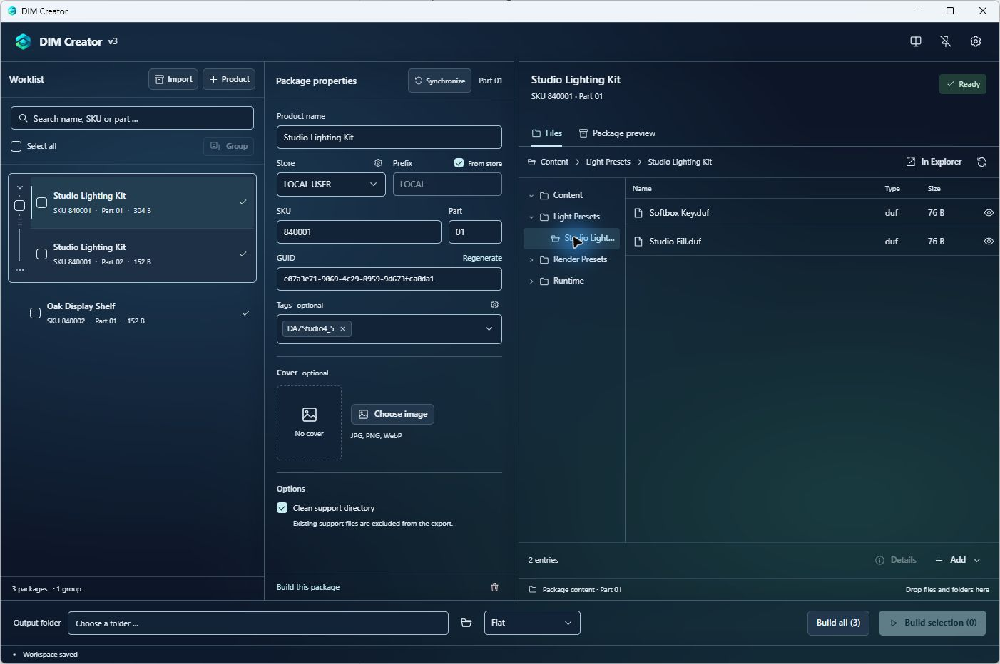

<p align="center">
  
</p>
<h1 align="center">DIM Creator</h1>
<p align="center">Build DAZ Install Manager packages from local files and ZIP, RAR or 7z archives.</p>

<p align="center">
  <strong><a href="https://github.com/H1ghSyst3m/DIM-Creator/releases/latest">Download for Windows</a></strong><br>
  <a href="#quick-start">Quick start</a>
  · <a href="#build-from-source">Build from source</a>
</p>
<p align="center">
  <a href="https://github.com/H1ghSyst3m/DIM-Creator/releases/latest"></a>
  <a href="https://github.com/H1ghSyst3m/DIM-Creator/releases"></a>
  <a href="https://github.com/H1ghSyst3m/DIM-Creator/releases/latest"></a>
</p>



## Download & install

Open the [latest release](https://github.com/H1ghSyst3m/DIM-Creator/releases/latest) and run the Windows x64 installer, `DIM-Creator_<version>_x64-setup.exe`. The app uses [Microsoft Edge WebView2 Runtime](https://developer.microsoft.com/microsoft-edge/webview2/).

To verify the installer, run `Get-FileHash .\DIM-Creator_*_x64-setup.exe -Algorithm SHA256` in PowerShell and compare the result with `SHA256SUMS.txt` from the same release.

## Quick start

1. **Bring in your files.** For a folder, click **+ Product** and add files or folders from the **Files** panel. Library folders such as `data`, `People` and `Runtime` go directly under `Content`. For a ZIP, RAR or 7z archive, use **Import** in the worklist or drop it on the worklist. Review the destination and any file conflicts before importing.
2. **Fill in the package details.** Enter a product name and a numeric SKU greater than zero with at most eight digits. Choose a store and check the part number. Add tags or a cover if you need them.
3. **Build the ZIP.** Choose an **Output folder**, then click **Build this package** or tick packages and click **Build selection**. If the build is blocked, open the package status to see what needs fixing.
4. **Install it with DIM.** Put the ZIP in DAZ Install Manager’s configured **Package Archive** folder. Refresh DIM, find the package under **Ready to Install**, and check the destination library before installing. [DAZ Install Manager guide](https://docs.daz3d.com/public/software/install_manager/userguide/use_install_manager/tutorials/installing_with_install_manager/start)

## Features

- **Archive import.** Inspect nested ZIP, RAR and 7z archives and assign their contents to new or existing packages. Use **Save as template** to keep an original archive in the template folder set under **Settings → General**.
- **Package groups.** Keep related products or parts together in the worklist. Use **Synchronize…** to copy selected product fields or renumber parts across the group. Preview the changes before applying them.
- **Files and preview.** Browse the content, exclude files from the ZIP without removing them from the draft, and check for missing or invalid package details.
- **Batch export.** Build one package, a selection or the whole worklist. Write ZIPs straight to the output folder or into dated subfolders.
- **Workspace preferences.** Set your usual store and tags for new packages. Choose from eight Classic and Glass themes, or use the header pin to keep DIM Creator above other windows.

## Files & workspace

A DIM package contains `Manifest.dsx`, `Supplement.dsx` and the staged files under `Content/`. The ZIP filename comes from the prefix, SKU, part number and product name.

Package drafts, their copied files and covers, the worklist and settings live under `%LOCALAPPDATA%\com.dimcreator`. Close DIM Creator before backing up that folder. Finished ZIPs go to the output folder you selected.

## Build from source

On Windows x64, install Node.js 24, Rust stable with the MSVC toolchain, Visual Studio C++ Build Tools with the Windows SDK, and WebView2 Runtime. From the repository root:

```powershell
npm ci
npm run tauri -- dev
```

Build the NSIS installer with `npm run tauri -- build --ci -- --locked`. The setup file is written to `target/release/bundle/nsis/`.

| Command | Check |
| --- | --- |
| `npm run typecheck` | TypeScript types |
| `npm test` | Frontend tests |
| `cargo test --workspace --locked` | Rust workspace tests |
| `npm run bindings:check` | Generated TypeScript types match the Rust commands |

DIM Creator 3.0 replaced the Python/PySide6 application with a [Rust core](core/), a [Tauri desktop shell](src-tauri/) and a [React/TypeScript interface](src/). The [Python edition](legacy/README.md) remains available with its own source and build instructions.

[Changelog](CHANGELOG.md) · [Report a bug](https://github.com/H1ghSyst3m/DIM-Creator/issues/new/choose) · [AGPL-3.0-only license](LICENSE)
